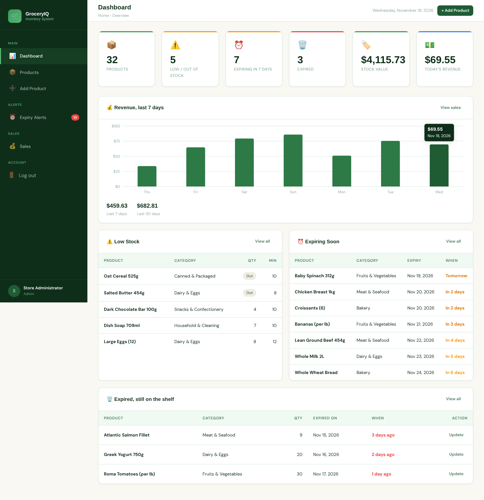
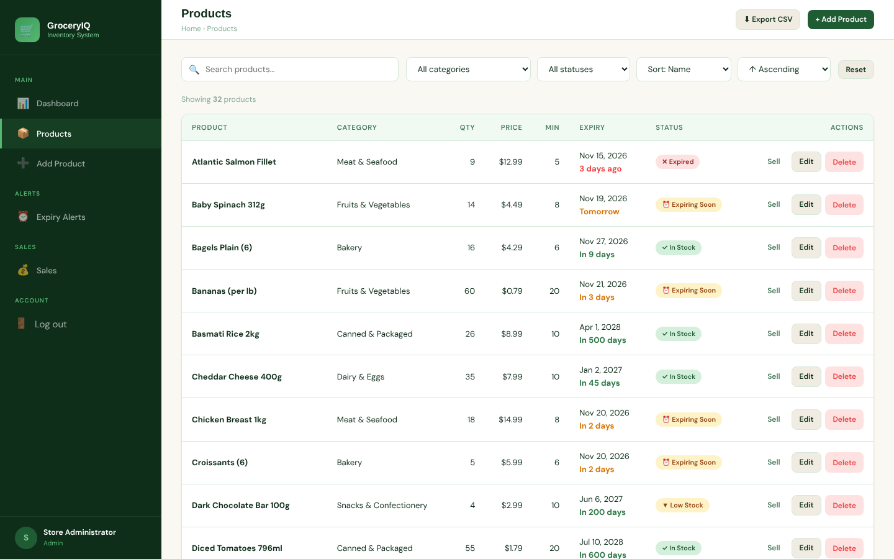
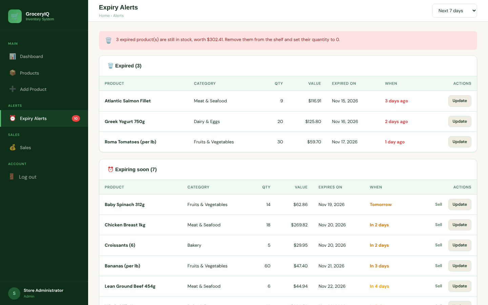
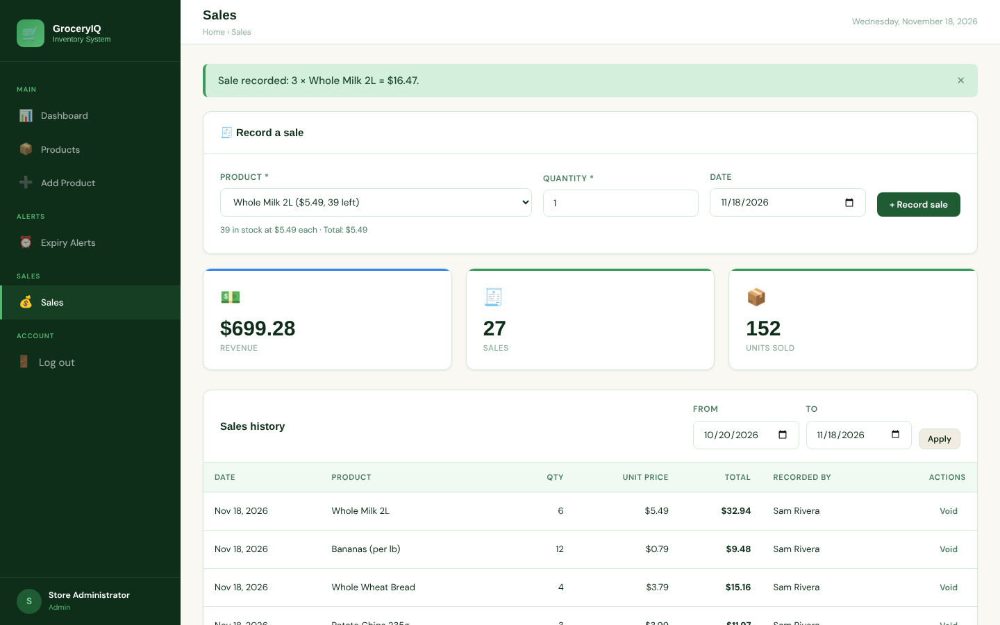
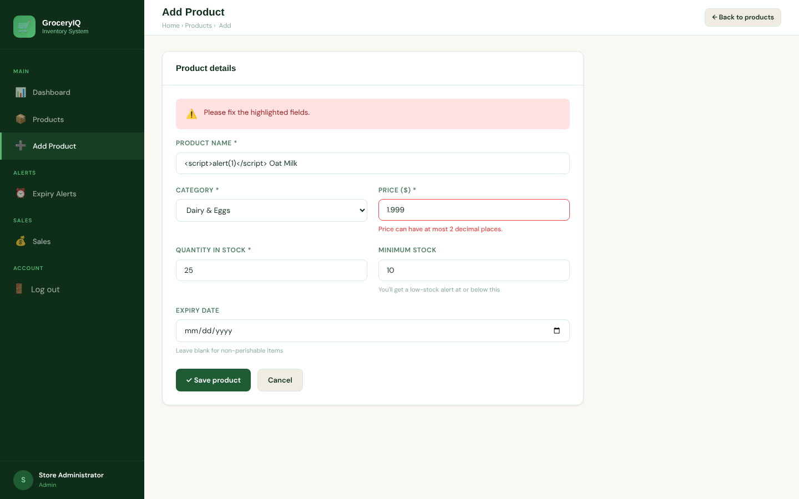
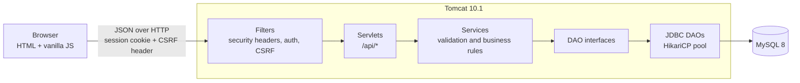

# 🛒 GroceryIQ: Smart Grocery Inventory System


A web app for a small grocery store to track stock, catch products before they expire, and record sales.
It's built with **plain Jakarta Servlets, JDBC and vanilla JavaScript** (no frameworks), so every layer
is visible: routing, transactions, authentication, CSRF protection and the UI.



## Features

- **Dashboard**: stock counts by status, stock value, today's revenue and a 7-day revenue chart.
- **Product management**: add, edit and delete products; search, filter by category or status, sort, and export to CSV.
- **Smart status**: every product is automatically *In Stock*, *Low Stock*, *Out of Stock*, *Expiring Soon* or *Expired*.
- **Expiry alerts**: expired items still on the shelf (with their value) and items expiring in the next 3–30 days.
- **Sales tracking**: record sales (stock goes down automatically), view history by date range, and void mistakes (stock goes back up).
- **Roles**: `ADMIN` can delete products and void sales; `STAFF` can do everything else.
- **Responsive** layout that works on phones.

| Products | Expiry alerts |
|---|---|
|  |  |
| **Sales** | **Validation** |
|  |  |

## Quick start (Docker)

The only thing you need is [Docker](https://www.docker.com/).

```bash
git clone https://github.com/Suhib05/grocery-inventory-system.git
cd grocery-inventory-system
docker compose up --build
```

Open **http://localhost:8080** and log in:

| Username | Password    | Role  |
|----------|-------------|-------|
| `admin`  | `Admin@123` | ADMIN |
| `staff`  | `Staff@123` | STAFF |

The demo data uses dates relative to today, so there are always some expiring and expired products to look at.
To start over with fresh data: `docker compose down -v && docker compose up --build`.

## Run without Docker

Requirements: JDK 17+, Maven 3.9+, MySQL 8, Tomcat 10.1+.

```bash
# 1. Create the database, an app user, and load the demo data
mysql -u root -p -e "CREATE USER 'grocery_app'@'localhost' IDENTIFIED BY 'grocery_pass';"
mysql -u root -p < database/schema.sql
mysql -u root -p < database/seed.sql
mysql -u root -p -e "GRANT SELECT, INSERT, UPDATE, DELETE ON grocery_inventory.* TO 'grocery_app'@'localhost';"

# 2. Build (this also runs the tests)
mvn package

# 3. Point the app at your database and deploy target/grocery-inventory.war to Tomcat
export DB_URL="jdbc:mysql://localhost:3306/grocery_inventory"
export DB_USER=grocery_app
export DB_PASSWORD=grocery_pass
```

| Variable       | Default                                            |
|----------------|----------------------------------------------------|
| `DB_URL`       | `jdbc:mysql://localhost:3306/grocery_inventory?...`|
| `DB_USER`      | `grocery_app`                                      |
| `DB_PASSWORD`  | *(empty)*                                          |
| `DB_POOL_SIZE` | `10`                                               |

## Architecture



| Layer | Package | Responsibility |
|---|---|---|
| Web | `web`, `web.api`, `web.filter` | HTTP only: parse requests, call a service, write JSON. `ApiServlet` turns exceptions into consistent error responses (400/403/404/409/429/500). |
| Service | `service` | Business rules: validation, product status, "can't sell expired food", stock checks, reports. Has no knowledge of HTTP or SQL. |
| DAO | `dao`, `dao.jdbc` | Data access behind interfaces, so services are tested with in-memory fakes. |
| Model | `model` | Immutable Java records. |
| Config | `config` | Wires everything together at startup (no DI framework) and reads settings from environment variables. |

More detail: [docs/architecture.md](docs/architecture.md).

### REST API

All endpoints need a logged-in session. Requests that change data must send the `X-CSRF-Token` header.

| Method | Path | Description |
|---|---|---|
| `POST` | `/api/auth/login` | Log in `{username, password}` |
| `POST` | `/api/auth/logout` | Log out |
| `GET`  | `/api/auth/me` | Current user + CSRF token |
| `GET`  | `/api/dashboard` | Dashboard summary |
| `GET`  | `/api/products?q=&categoryId=&status=&sort=&order=` | Search / filter / sort products |
| `GET`  | `/api/products/export?...` | Same filters, as CSV |
| `GET`  | `/api/products/{id}` | One product |
| `POST` | `/api/products` | Create |
| `PUT`  | `/api/products/{id}` | Update |
| `DELETE` | `/api/products/{id}` | Archive *(admin)* |
| `GET`  | `/api/categories` | Categories |
| `GET`  | `/api/alerts?days=7` | Expired and expiring-soon products |
| `GET`  | `/api/sales?from=&to=` | Sales report for a date range |
| `POST` | `/api/sales` | Record a sale `{productId, quantity, saleDate?}` |
| `POST` | `/api/sales/{id}/void` | Void a sale and restore stock *(admin)* |

## Security

- **Passwords** are hashed with salted **PBKDF2-HMAC-SHA256 (600,000 iterations**, the OWASP recommendation), compared in constant time. Unknown usernames take the same time to reject, so attackers can't discover which usernames exist.
- **Brute-force protection**: 5 failed logins lock that username for 5 minutes (HTTP 429).
- **Sessions**: `HttpOnly` + `SameSite=Lax` cookie, new session id on login (prevents session fixation), 30-minute timeout.
- **CSRF**: every data-changing API call must carry a per-session token in a custom header.
- **SQL injection**: only prepared statements; sort columns come from an enum whitelist; `LIKE` wildcards are escaped.
- **XSS**: all data is escaped before it's put into the page, and a strict **Content-Security-Policy** blocks inline scripts.
- **CSV injection**: exported cells that start with `=`, `+`, `-` or `@` are neutralised.
- **Authorization** is checked on the server, not just hidden in the UI.
- **No secrets in code**: database credentials come from environment variables.

## Design decisions

- **Status is calculated, never stored.** A stored "expired" flag goes stale at midnight. `Product.statusOn(date)` is the single source of truth, and it takes the date as a parameter so it's easy to test.
- **Selling is atomic and race-safe.** The stock update is conditional (`... WHERE quantity >= ?`) and runs in the same transaction as the sale insert. Two cashiers selling the last item at the same moment can't push stock below zero.
- **Prices come from the server.** A sale stores the product's price at the time of sale; the client only sends a product id and quantity. `total_amount` is a generated column, so it can't disagree with quantity × price.
- **Nothing important is hard-deleted.** Products are archived and sales are voided, so the sales history and audit trail stay intact.
- **Money is `BigDecimal` / `DECIMAL`**, never floating point.
- **Dates use `java.time`** all the way to JDBC (`getObject(..., LocalDate.class)`), which avoids off-by-one-day time zone bugs.
- **Time is injected** (`java.time.Clock`) so expiry logic and login lockouts can be tested without waiting.

## Testing

```bash
mvn test        # unit tests
mvn verify      # tests + JaCoCo coverage report in target/site/jacoco/
```

The tests cover the status rules, validation, the sale and void flows (including the race condition), login lockout, password hashing, CSV escaping and JSON parsing.
Services are tested against in-memory DAO fakes (`src/test/java/com/grocery/support`), so no database is needed.
GitHub Actions runs the build, the tests and a Docker build on every push.

## Project structure

```
├── database/            schema.sql, seed.sql
├── docs/                architecture notes and screenshots
├── src/main/java/com/grocery/
│   ├── config/          startup wiring, environment config
│   ├── model/           records: Product, Sale, User, ...
│   ├── dao/ + jdbc/     data access interfaces + JDBC implementations
│   ├── service/         business rules
│   ├── util/            PasswordHasher, CsvWriter
│   └── web/             servlets, filters, JSON
├── src/main/webapp/     HTML pages, css/, js/
├── src/test/java/       JUnit 5 tests + in-memory fakes
├── Dockerfile, docker-compose.yml
└── .github/workflows/ci.yml
```

## Roadmap

- Integration tests for the JDBC layer with Testcontainers (real MySQL in CI)
- User management page for admins
- Suppliers and purchase orders (restocking)
- Pagination for large product lists
- Email alerts for products about to expire

## License

[MIT](LICENSE)
