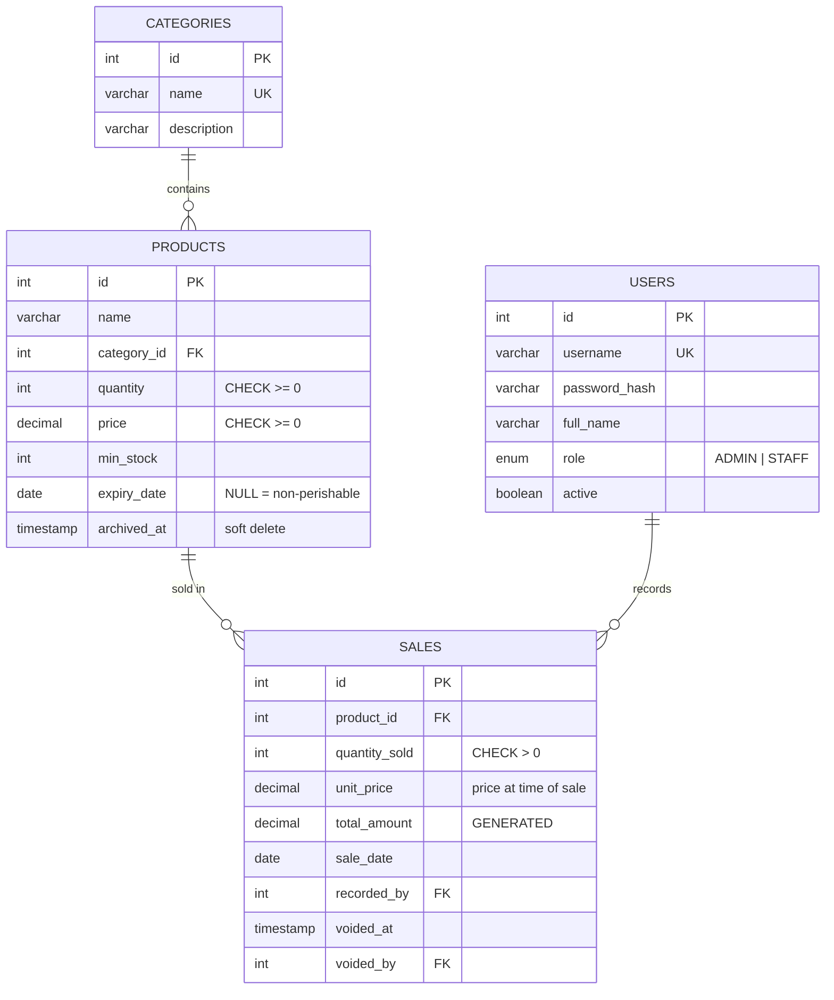
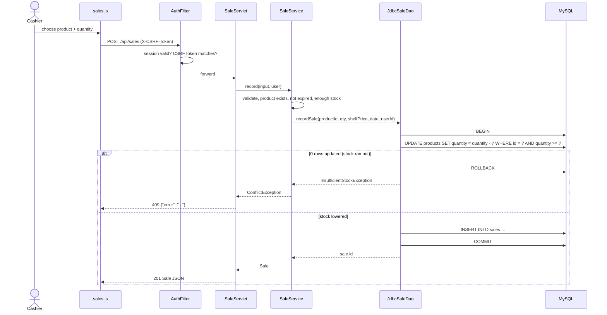

# Architecture notes

## Database



## Recording a sale



The service checks stock first so it can return a friendly message. The conditional `UPDATE` is what makes the
operation safe: if another cashier sells the last units between the check and the update, no rows are updated
and the whole transaction is rolled back.

## Product status rules

Status is worked out every time a product is read, in this order (the first rule that matches wins):

| # | Rule | Status |
|---|---|---|
| 1 | quantity is 0 | Out of Stock |
| 2 | expiry date is before today | Expired |
| 3 | expiry date is today to 7 days from now | Expiring Soon |
| 4 | quantity ≤ minimum stock | Low Stock |
| 5 | otherwise | In Stock |

Out of Stock comes first because when there's nothing on the shelf, the expiry date no longer matters.

## Error responses

Every API error has the same shape, so the frontend handles them all the same way:

```json
{ "error": "Please fix the highlighted fields.",
  "fieldErrors": { "price": "Price can have at most 2 decimal places." } }
```

| Status | When |
|---|---|
| 400 | Invalid input (`ValidationException`) or malformed JSON |
| 401 | Not logged in / session expired |
| 403 | Missing CSRF token, or a STAFF user trying an ADMIN action |
| 404 | Unknown product or sale |
| 409 | Conflicts with current data (not enough stock, expired product, sale already voided) |
| 429 | Too many failed logins |
| 500 | Unexpected error (logged on the server; details are not sent to the browser) |
